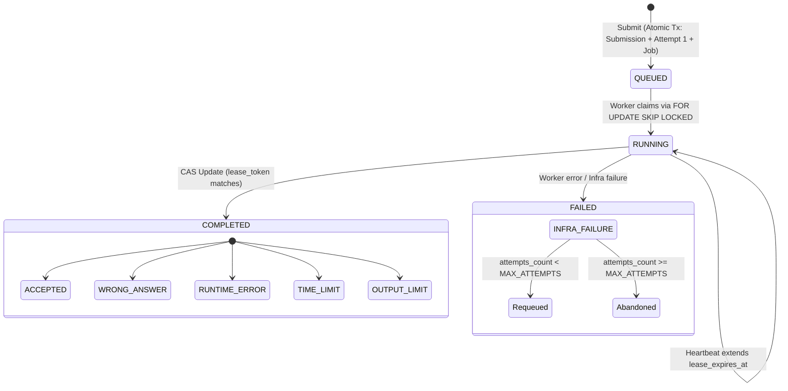

# Shodh a Code – Contest Platform Backend

A production-grade, deterministic coding contest platform backend built with NestJS, Prisma ORM, and PostgreSQL. Designed to run completely without Redis or third-party queue systems, using PostgreSQL as the atomic transaction log and job queue (`FOR UPDATE SKIP LOCKED`).

---

## 1. One-Command Quickstart

Start the entire system (Database, Migrations, Seed Data, API, and 2 Worker replicas):

```bash
docker compose up --build
```

The system will:
1. Launch PostgreSQL 16 on port 5432 and wait for healthy status.
2. Automatically execute database migrations and deterministic seed data.
3. Start the NestJS REST API server on `http://localhost:3000`.
4. Start 2 background worker replicas (`shodh-contest-backend-worker-1` and `worker-2`) polling PostgreSQL for judging tasks.

Interactive Swagger/OpenAPI documentation is available at:
```
http://localhost:3000/docs
```

---

## 2. Sample Identities & Dev Auth Fixture

Authentication uses a trusted development HMAC-SHA256 signature fixture:
* `x-dev-user-id`: User UUID
* `x-dev-signature`: `HMAC_SHA256(userId, DEV_AUTH_SECRET)`

| User Handle | User ID | Organization | Org ID | Role |
| :--- | :--- | :--- | :--- | :--- |
| `alpha_admin` | `user-org1-organizer` | Alpha Algorithms | `org-alpha` | **ORGANIZER** |
| `alice_coder` | `user-org1-participant1` | Alpha Algorithms | `org-alpha` | **PARTICIPANT** |
| `bob_coder` | `user-org1-participant2` | Alpha Algorithms | `org-alpha` | **PARTICIPANT** |
| `beta_admin` | `user-org2-organizer` | Beta Byte | `org-beta` | **ORGANIZER** |
| `charlie_coder`| `user-org2-participant1` | Beta Byte | `org-beta` | **PARTICIPANT** |

### Helper to Generate HMAC Signatures

You can use the helper script `scripts/sign.sh`:
```bash
./scripts/sign.sh user-org1-participant1
# Outputs: 98cce5625041feb9acce4c39b8545034f79b9245c5731b64cef96fdc886f301f
```

Or manually using OpenSSL:
```bash
SECRET="change_me_dev_only"
USER_ID="user-org1-participant1"
SIGNATURE=$(printf "%s" "$USER_ID" | openssl dgst -sha256 -hmac "$SECRET" | awk '{print $NF}')
```

---

## 3. Example cURL Requests

### A. List Contests
```bash
curl -X GET http://localhost:3000/contests \
  -H "x-dev-user-id: user-org1-participant1" \
  -H "x-dev-signature: 98cce5625041feb9acce4c39b8545034f79b9245c5731b64cef96fdc886f301f"
```

### B. Submit Code to Contest
```bash
curl -X POST http://localhost:3000/contests/contest-alpha-live/submissions \
  -H "Content-Type: application/json" \
  -H "x-dev-user-id: user-org1-participant1" \
  -H "x-dev-signature: 98cce5625041feb9acce4c39b8545034f79b9245c5731b64cef96fdc886f301f" \
  -d '{
    "problemId": "prob-two-sum",
    "code": "import sys\na, b = map(int, sys.stdin.read().split())\nprint(a + b)\n",
    "language": "python",
    "idempotencyKey": "sub-alice-curl-001"
  }'
```

### C. Get Submission Status
```bash
curl -X GET http://localhost:3000/submissions/<SUBMISSION_ID> \
  -H "x-dev-user-id: user-org1-participant1" \
  -H "x-dev-signature: 98cce5625041feb9acce4c39b8545034f79b9245c5731b64cef96fdc886f301f"
```

### D. Get Live Leaderboard
```bash
curl -i -X GET http://localhost:3000/contests/contest-alpha-live/leaderboard \
  -H "x-dev-user-id: user-org1-participant1" \
  -H "x-dev-signature: 98cce5625041feb9acce4c39b8545034f79b9245c5731b64cef96fdc886f301f"
```

### E. Organizer Rejudge
```bash
curl -X POST http://localhost:3000/submissions/<SUBMISSION_ID>/rejudge \
  -H "Content-Type: application/json" \
  -H "x-dev-user-id: user-org1-organizer" \
  -H "x-dev-signature: 355f92a6643f80a58bba8bcf960dd4894fbdfbd821d212a60a42707b3fad055d" \
  -d '{}'
```

---

## 4. Deterministic Scoring Rules

1. **Submission Window**: Submissions are permitted strictly while `contest.start_time <= now < contest.end_time` and user has joined.
2. **Points**: Awarded upon the first `ACCEPTED` attempt on a problem (`points` defined by problem version).
3. **Penalties**:
   * Each failed attempt prior to the first accepted attempt on that problem adds **10 minutes** penalty.
   * `INFRA_FAILURE` attempts **never** count as wrong attempts and do not add penalty.
   * Elapsed minutes from `contest.start_time` to the accepted attempt timestamp are added to penalty: `Math.floor((accepted_at - contest.start_time) / 60000)`.
   * Submissions or attempts after acceptance on that problem are ignored.
4. **Tie-Breaking Order**:
   1. `totalScore DESC` (Higher score wins)
   2. `totalPenalty ASC` (Lower penalty wins)
   3. `lastAcceptedAt ASC` (Earlier finish wins, nulls last)
   4. `userId ASC` (Lexicographical ID order)

---

## 5. Authorization Matrix

| Endpoint | Method | Required Role | Cross-Org Access | Participant Own-Resource Restriction |
| :--- | :---: | :---: | :---: | :---: |
| `/contests` | `POST` | `ORGANIZER` | 404 (if org unknown) | N/A |
| `/contests` | `GET` | Authenticated | Scoped to user orgs | N/A |
| `/contests/:id` | `GET` | Authenticated | **404 Not Found** | N/A |
| `/contests/:id/join` | `POST` | `PARTICIPANT` | **404 Not Found** | N/A |
| `/contests/:id/problems` | `POST` | `ORGANIZER` | **404 Not Found** | 403 Forbidden for Participant |
| `/problems/:id/versions` | `POST` | `ORGANIZER` | **404 Not Found** | 403 Forbidden for Participant |
| `/contests/:id/submissions` | `POST` | `PARTICIPANT` | **404 Not Found** | Must be joined in contest |
| `/submissions/:id` | `GET` | Authenticated | **404 Not Found** | Participant views **own code only** (403 for others) |
| `/contests/:id/submissions` | `GET` | Authenticated | **404 Not Found** | Others' code redacted for participants |
| `/submissions/:id/rejudge` | `POST` | `ORGANIZER` | **404 Not Found** | 403 Forbidden for Participant |
| `/attempts/:id` | `GET` | Authenticated | **404 Not Found** | Participant: hidden test cases **redacted** |
| `/judge/*` | `*` | Worker / Token | N/A | Guarded by `x-judge-token` |

> **Privacy Guarantee**: Hidden test cases (`is_hidden = true`) never expose `input` or `expected_output` to participants in responses or logs.

---

## 6. State Machine Diagram



---

## 7. Guarantee Boundaries: Storage vs Worker Protocol vs Runner

| Guarantee | Storage Layer (Postgres) | Worker Protocol | Runner Sandbox |
| :--- | :--- | :--- | :--- |
| **Idempotency** | `UNIQUE(contest_id, user_id, idempotency_key)` prevents double rows across restarts and parallel requests. | Deduplicates incoming payload hashes (`request_hash`). | N/A |
| **Exclusive Claim** | `SELECT ... FOR UPDATE SKIP LOCKED` locks rows at row-level without blocking other workers. | Lease tokens (`lease_token`) prevent duplicate executions. | N/A |
| **Stale Worker Prevention** | Atomic CAS (`WHERE id=$1 AND status='RUNNING' AND lease_token=$2`) drops stale writes (0 rows updated). | Discards abandoned execution if lease expired or was reclaimed. | N/A |
| **Authoritative Ranking** | Updates `authoritative_attempt_id` and `standings` in the exact same transaction. | Resolves rejudge attempt ordering; late results from old attempts do not overwrite pointer. | N/A |
| **Sandbox Resource Bounds** | Enforces problem limits stored in versioned tables. | Injects CPU, memory, PID limits into container runtime. | Enforces `--memory 128m`, `--pids-limit 32`, `--cpus 0.5`, wall-time kill. |
| **Network & Filesystem Isolation**| N/A | Creates isolated read-only mounts per test case. | `--network none`, `--read-only`, non-root user `65534`, drops ALL capabilities. |

---

## 8. Isolation Limits & Production Hardening

### Current Docker Sandbox Boundaries
* **Shared Host Kernel**: The submitted Python code runs inside a Docker container sharing the host Linux kernel (`darwin/linux` VM). While processes are separated by Linux cgroups, namespaces, and seccomp/capabilities restrictions, kernel vulnerabilities (e.g. kernel privilege escalations) could theoretically affect the host kernel.
* **Storage Mounts**: The runner container receives **no Docker socket** access, no host volumes except an ephemeral temporary directory mounted read-only (`:ro`) containing `solution.py`, and a size-capped `tmpfs` at `/tmp`.
* **User & Capabilities**: Executed as unprivileged user `nobody:nobody` (`65534:65534`) with `--cap-drop ALL` and `--security-opt no-new-privileges`.

### Recommended Next Steps for Production
1. **gVisor (`runsc`)**: Replace the default `runc` runtime with Google's gVisor runtime (`runsc`) to run submitted user code in a dedicated userspace application kernel, eliminating direct host kernel syscall exposure.
2. **MicroVM Isolation (Firecracker / Kata Containers)**: For multi-tenant hosting at scale, run worker execution within lightweight virtual machines (MicroVMs) booting in <100ms.
